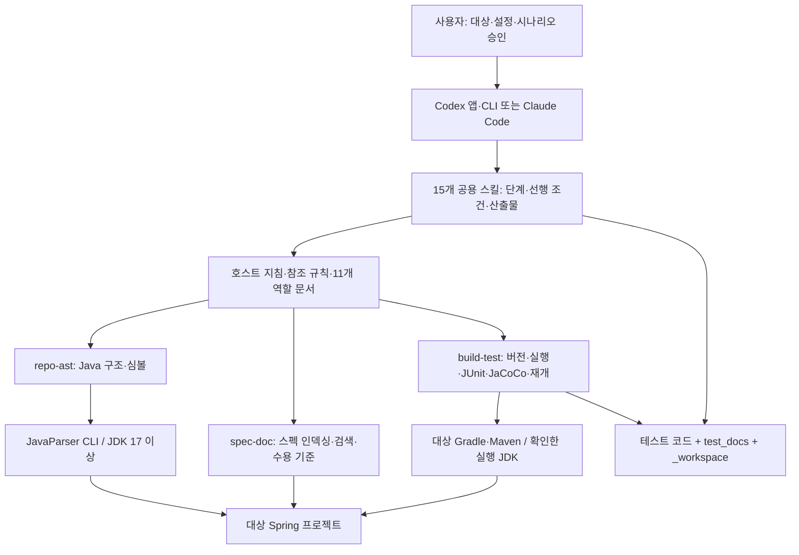

# 하네스 사용 흐름과 내부 구조

이 플러그인은 Spring 프로젝트의 스펙과 실제 소스를 읽고, 승인된 시나리오의 테스트를 생성·실행·보정하는 도구다. 설치·실행 예시는 [Codex 가이드](CODEX.md), 상세 단계는 [파이프라인](pipeline-flow.md)을 따른다.

## 사용 흐름

1. 플러그인을 설치하고 **테스트를 생성할 Spring 프로젝트**를 Codex에서 연다.
2. `setup-harness`를 요청해 MCP 3개와 JavaParser를 준비한다.
3. `full-pipeline`에 절대 `projectRoot`, 스펙 경로, 대상 패키지·클래스를 전달한다. 설정이 없으면 `configure-harness`가 실제 버전·대상·커버리지 기준을 확정한다.
4. 제시된 시나리오를 읽고 승인·수정·제외한다. 승인한 시나리오만 테스트로 만든다.
5. JUnit 실행·실패 보정, JaCoCo 임계값, 시나리오 적합성 결과를 확인한다. 실행이 막히거나 기준을 충족하지 못하면 남은 항목을 보고한다.

Codex 대화에 입력하는 예시:

```text
test-autoevermation-harness-plugin의 setup-harness로 환경을 준비해줘.
projectRoot는 C:\work\order-service야. MCP 3종 health를 실제로 확인해줘.
```

준비 후:

```text
test-autoevermation-harness-plugin의 full-pipeline을 실행해줘.
projectRoot: C:\work\order-service
스펙: docs/orders.md
대상: com.example.order
실제 Spring·Java·빌드 버전을 확인하고 커버리지 기준을 설정해줘.
시나리오를 먼저 보여주고 내가 승인한 것만 테스트로 만들어줘.
실행·보정·JaCoCo·시나리오 적합성까지 확인해줘.
```

## 구성요소



스킬·역할 문서는 모델이 수행할 절차와 판단 기준이다. JavaParser와 MCP는 그 판단에 필요한 구조·실행 결과를 제공한다. Python 서버가 단독으로 전체 파이프라인을 실행하거나 테스트 코드를 모두 생성하는 구조가 아니다.

| 위치 | 역할 |
|---|---|
| 저장소 `.agents/plugins/marketplace.json` | Codex 로컬·Git 마켓플레이스 카탈로그 |
| `plugin.json`, `mcp.json` | Codex 패키지·공용 스킬·MCP 연결. Codex hooks는 빈 객체 |
| `.claude-plugin/plugin.json`, `.mcp.json`, `.lsp.json`, `hooks/` | 기존 Claude 패키지·MCP·JDT LS·단계/쓰기 훅 |
| `skills/*/SKILL.md` | 설정·분석·승인·생성·실행·보정·검증 등 15개 진입점 |
| `agents/*.md` | 스펙 분석·소스 분석·테스트 생성·실행/커버리지 보정 등의 11개 역할 지침 |
| `references/` | 스키마·버전·호스트·승인·반복 종료·근거 조사 계약 |
| `mcp/launch.cjs`, `bootstrap.py` | Node 진입점, Python 선택·SDK 준비·stdio 연결·종료 전달 |
| `mcp/repo_ast_server.py`, `javaparser-cli/` | 5개 도구. 파일·타입·메서드·필드·호출·미해결 심볼 분석 |
| `mcp/spec_doc_server.py` | 4개 도구. 한 프로젝트의 스펙 스냅샷을 일괄 인덱싱·검색·추출 |
| `mcp/build_test_server.py` | 11개 도구. 실제 빌드 설정·태스크·테스트·커버리지·최신성 확인 |
| `scripts/` | JavaParser jar 영속화, 환경/JDT 준비, Claude 산출물 가드·상태줄 |
| `examples/` | Boot/Java 조합별 테스트·Gradle·Maven·CI 참고 템플릿 |
| `tests/` | 기존 하네스 검사. 생성 대상 프로젝트의 테스트와 별개 |

## 경로와 데이터

세 위치를 구분한다.

- **설치 폴더 `PLUGIN_ROOT`**: 스킬·서버·Java CLI 소스. 업데이트 시 바뀔 수 있다.
- **영속 데이터 `PLUGIN_DATA`**: Python 환경·JavaParser jar·지문. Claude는 `CLAUDE_PLUGIN_DATA`를 사용한다.
- **대상 `projectRoot`**: 사용자가 테스트를 만들 Spring 저장소. Codex의 프로젝트 접근 MCP 호출마다 확정한 절대 `root`로 전달한다.

MCP 프로세스의 작업 폴더는 대상 프로젝트와 같다고 가정하지 않는다. 상대 입력은 `root` 기준으로 해석하고 기존 접근 경계를 넘지 않는다. 스펙 인덱스는 메모리에 보관하며 다른 root로 검색하면 재인덱싱을 요구한다.

대상 프로젝트의 주요 산출물:

```text
src/test/java/                         생성 테스트 (실제 모듈·소스셋에 따름)
test_docs/scenarios/<SC-ID>.md          승인 시나리오·테스트 매핑·검증 결과
test_docs/INDEX.md                     사람이 읽는 결과 인덱스
_workspace/00_config-harness.json       설정, schemaVersion: 2
_workspace/04b_approval.json            승인·수정·제외
_workspace/06_run_result.json           최신 JUnit 실행 결과
_workspace/08_coverage_result.json      커버리지·게이트·잔여 부족분
_workspace/09_conformance.json          시나리오 적합성
_workspace/build-test-evidence.json    실행 입력·보고서 SHA-256
_workspace/pipeline_result.json        전체 단계 상태·다음 조치
```

JUnit/JaCoCo 원본 XML은 각 모듈의 `build/` 또는 `target/` 아래에 생성한다. 커스텀 태스크·리포트 경로는 실제 빌드에서 확인하여 설정에 전달한다. 낡은 XML이나 `_workspace`의 이전 성공 표시만으로 완료하지 않는다.

## 호스트별 실행 차이와 완료 조건

Codex는 순차 실행을 기본으로 하며 JavaParser·소스·컴파일 결과를 사용한다. 제공된 도구가 있을 때만 독립적인 스펙·AST 분석을 선택적으로 위임한다. JDT LS·Claude 상태줄·강제 훅은 사용하지 않고 `lspAvailable:false`를 기록한다. 승인과 순서는 스킬 지침으로 관리한다. Claude는 기존 Agent/LSP/훅 경로를 사용한다. 공용 규칙은 [host-runtime.md](../references/host-runtime.md)에 연결되어 있다.

완료에는 **승인된 시나리오 + 최신 JUnit 성공 + JaCoCo 기준 충족 + 최신 시나리오 적합성**이 모두 필요하다. 소스·스펙·빌드·리소스가 바뀌면 증거를 다시 확인한다. 실패는 원인부터 분석하고 기존 반복 한도 안에서 보정한다. 테스트 생성을 위해 별도 메타 테스트·mutation testing·의무 RED–GREEN TDD를 추가하지 않는다.

현재 실행·미실행 범위는 [호환성 수정 기록](compatibility-remediation.md)에 명시한다. 패키지 구성은 [OpenAI 공식 문서](https://developers.openai.com/plugins/build/plugins), 스킬 작성은 [공식 스킬 지침](https://developers.openai.com/plugins/build/skills)을 근거로 한다.
