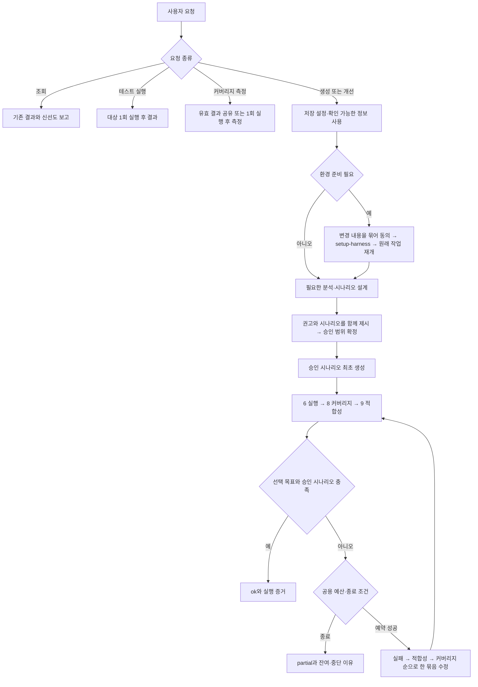

# 요청별 실행 흐름

정본: [full-pipeline](../skills/full-pipeline/SKILL.md), [공용 정책](../references/execution-policy.md).
양쪽 호스트에서 메인이 역할을 직접 수행한다. Claude는 JDT LS와 승인·순서 훅, Codex는 JavaParser·소스 근거를 사용한다.

빠름 총 1회·균형 총 3회는 모든 보정 원인을 합산한다. 마지막 수정 뒤 검증도 반드시 수행한다.
엄격/정책 없는 기존 설정은 동일 실패·gap 3회 무진전, 적합성 최대 3라운드·동일 unmet 즉시 종료를 유지한다.
자동 재개는 예산을 초기화하지 않는다. 전체 범위가 검증된 마지막 실행이면 별도 회귀 실행하지 않는다.
상세 산출물·재개: [오케스트레이션](../skills/full-pipeline/references/orchestration-detail.md).
